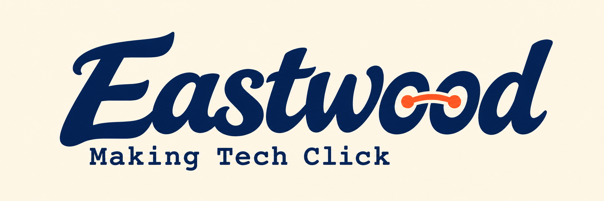

> Connecting the dots between imagination and tech. ✨ Making tech click. Vibe coding “what if” into “wait, you built that?” 🚀

## Hey, I’m Eastwood.

If I catch myself copying the same thing from one app into another, my first thought is usually, “Could I get these two talking?” That little orange wire in my logo is a pretty good picture of how my brain works.

I’m learning to code as I go, usually because there’s an idea I can’t quite leave alone.
